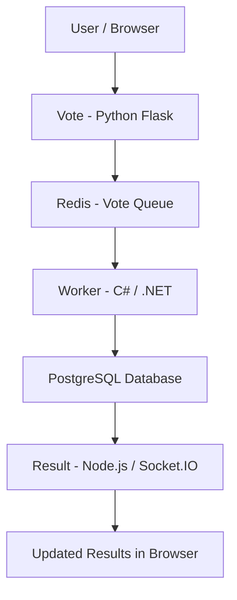
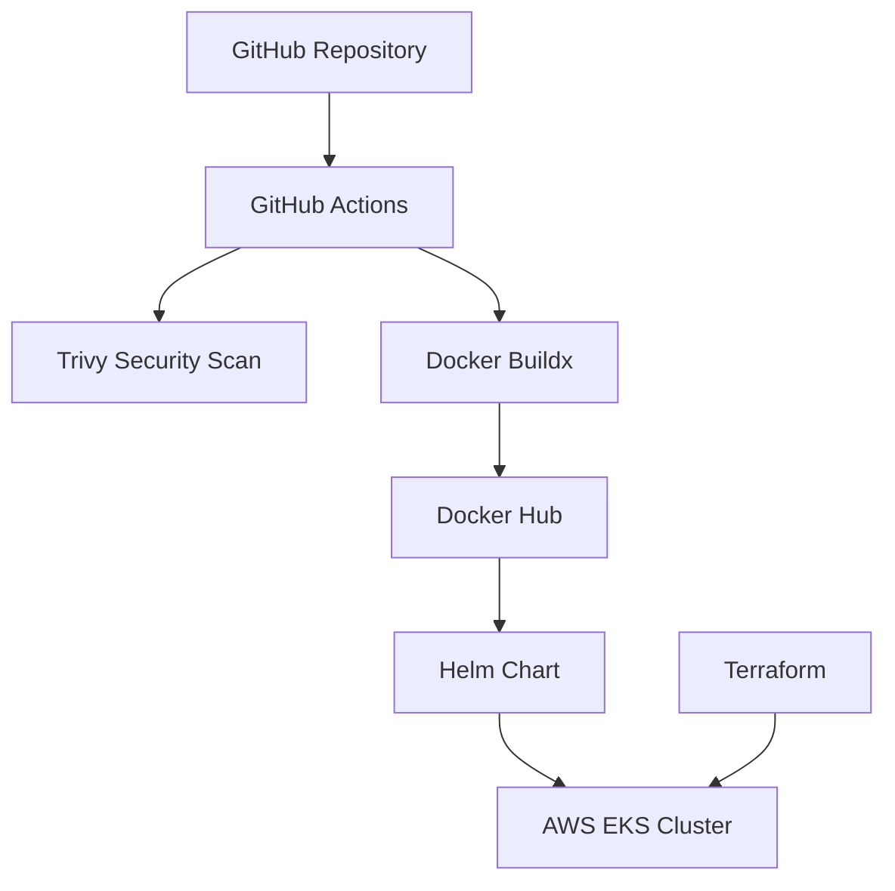

# Capstone 1: Voting Application on AWS EKS

## 1. Project Overview

This project deploys a containerized Voting Application to Amazon Elastic Kubernetes Service (EKS) using Terraform, Docker and Helm.

The application allows users to submit votes and view updated results. It uses Redis for temporary vote storage and PostgreSQL for persistent vote records.

The project demonstrates Infrastructure as Code (IaC), containerization, Kubernetes orchestration, CI/CD automation, security scanning and Helm release management.

## 2. Technologies and Tools

- AWS: Amazon EKS, EC2, IAM and VPC
- Terraform: Infrastructure provisioning
- Docker: Containerization
- Docker Hub: Container image registry
- Kubernetes: Container orchestration
- Helm: Kubernetes application deployment
- GitHub Actions: CI/CD automation
- Trivy: Security vulnerability scanning
- Python Flask: Voting application
- C# / .NET: Background worker
- Node.js and Socket.IO: Results application
- Redis: Temporary vote storage
- PostgreSQL: Persistent vote storage

## 3. Application Architecture

The application consists of five main components:

1. Vote: A Python Flask application that receives votes from users.
2. Redis: Stores submitted votes temporarily in a queue.
3. Worker: A C#/.NET application that retrieves votes from Redis and writes them to PostgreSQL.
4. PostgreSQL: Stores vote records.
5. Result: A Node.js application that retrieves vote counts from PostgreSQL and broadcasts updated results using Socket.IO.

### Application Data Flow



### Infrastructure and CI/CD Architecture



## 4. AWS Infrastructure Provisioning with Terraform

Terraform provisions the AWS infrastructure required for the application.

### Infrastructure Configuration

| Resource | Configuration |
|---|---|
| AWS Region | eu-north-1 |
| EKS Cluster | voting-app-cluster |
| Kubernetes Version | 1.35 |
| EC2 Instance Type | t3.small |
| Desired Nodes | 2 |
| Minimum Nodes | 1 |
| Maximum Nodes | 3 |

The Terraform configuration:

- Uses the default AWS VPC and its subnets.
- Creates an IAM role for the EKS control plane.
- Creates the EKS cluster.
- Configures cluster security group access.
- Creates an IAM role for worker nodes.
- Attaches the required EKS worker-node policies.
- Provisions an EKS managed node group.

### Terraform Commands

Navigate to the Terraform directory:

```bash
cd capstone-1-voting-app/terraform
```

Initialize Terraform:

```bash
terraform init
```

Review the infrastructure plan:

```bash
terraform plan
```

Apply the configuration:

```bash
terraform apply
```

Configure kubectl:

```bash
aws eks update-kubeconfig \
  --name voting-app-cluster \
  --region eu-north-1
```

## 5. Docker Containerization

The application components are containerized using Docker.

Three custom application images are published to Docker Hub:

| Component | Docker Hub Repository |
|---|---|
| Vote | hikmah2006/examplevotingapp_vote |
| Result | hikmah2006/examplevotingapp_result |
| Worker | hikmah2006/examplevotingapp_worker |

The images use the commit-based tag:

`23cf6e559659838062216cdcf5ceb046adf6439c`

Redis and PostgreSQL use their respective official container images.

## 6. CI/CD Pipeline with GitHub Actions

The GitHub Actions workflow is located at:

`.github/workflows/capstone-1-ci.yml`

The pipeline is triggered by:

- Pushes to the main branch.
- Pull requests targeting the main branch.
- Manual workflow execution.

### Pipeline Stages

**Stage 1: Security Scanning**

Trivy scans the repository filesystem for HIGH and CRITICAL vulnerabilities.

**Stage 2: Docker Image Building**

Docker Buildx builds the Vote, Result and Worker images.

**Stage 3: Image Publishing**

When the required Docker Hub credentials are configured, the pipeline publishes the images to Docker Hub.

Images are tagged using the Git commit SHA and `latest`.

The workflow uses GitHub repository secrets for Docker Hub authentication.

Note: Trivy findings are reported, but the current configuration does not fail the workflow when vulnerabilities are detected because its exit code is configured as 0.

The workflow automates image building and publishing. Helm deployment to EKS is performed separately.

## 7. Kubernetes Deployment with Helm

The application is deployed using a Helm chart located at:

`helm/voting-app/`

The chart defines five Kubernetes Deployments and four Services.

### Kubernetes Workloads

| Component | Deployment | Service |
|---|---|---|
| Vote | Yes | NodePort |
| Result | Yes | NodePort |
| Worker | Yes | No dedicated Service |
| Redis | Yes | ClusterIP |
| PostgreSQL | Yes | ClusterIP |

### Service Ports

| Service | Port | Type |
|---|---:|---|
| Vote | 31000 | NodePort |
| Result | 31001 | NodePort |
| Redis | 6379 | ClusterIP |
| PostgreSQL | 5432 | ClusterIP |

### Helm Installation

```bash
helm upgrade --install voting-app ./helm/voting-app \
  --namespace voting-app \
  --create-namespace
```

### Verify Deployment

```bash
kubectl get deployments,services -n voting-app
```

### Check Helm Release History

```bash
helm history voting-app -n voting-app
```

### Helm Rollback

```bash
helm rollback voting-app 1 -n voting-app
```

The project deployment history confirms:

- Revision 1: Initial installation.
- Revision 2: Upgrade.
- Revision 3: Successful rollback to revision 1.

The current deployed Helm release is `voting-app`, in the `voting-app` namespace.

## 8. Deployment Verification

The following Kubernetes resources were verified in the EKS cluster:

| Deployment | Ready Replicas |
|---|---:|
| Vote | 1/1 |
| Result | 1/1 |
| Worker | 1/1 |
| Redis | 1/1 |
| PostgreSQL | 1/1 |

All five deployments reported available replicas.

The Vote and Result services were configured as NodePort services, while Redis and PostgreSQL remained internal ClusterIP services.

## 9. Security Considerations

- Docker Hub credentials are supplied through GitHub Actions secrets.
- Terraform state files are excluded from Git using `.gitignore`.
- Trivy is used for repository security scanning.
- PostgreSQL credentials in the current Helm values are demonstration defaults. Production deployments should use Kubernetes Secrets or an appropriate secrets manager.
- Production deployments should also apply least-privilege IAM permissions and appropriate network restrictions.

## 10. Project Outcome

The project demonstrates the provisioning of AWS EKS infrastructure using Terraform, containerization of application components, automated security scanning and Docker image publishing through GitHub Actions, and Kubernetes deployment using Helm.

The application was deployed successfully, its five workloads were verified as available, and Helm upgrade and rollback operations were demonstrated.

### Project Repository

The source code, Terraform configuration, Helm chart and CI/CD workflow are maintained in this repository.
